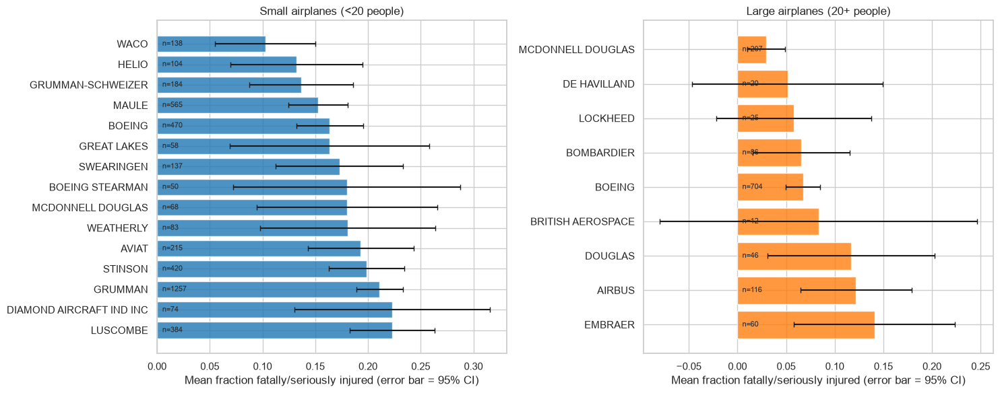
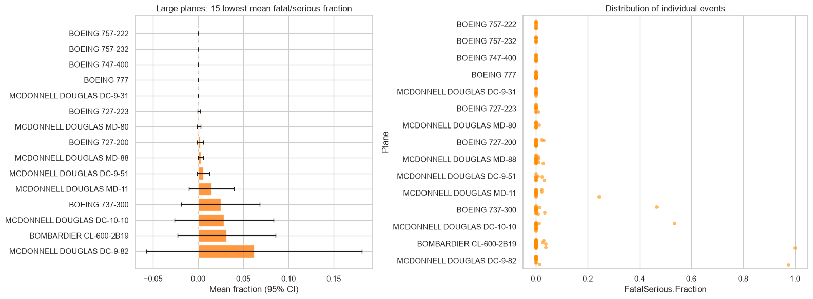
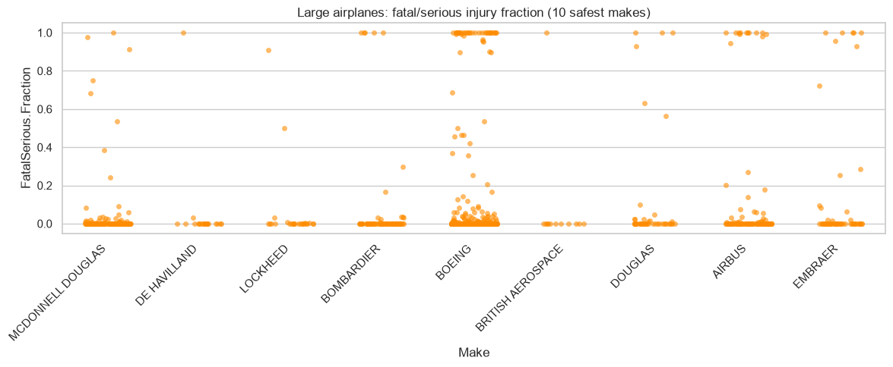
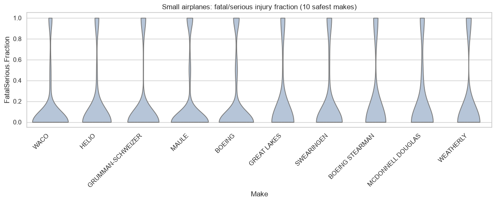
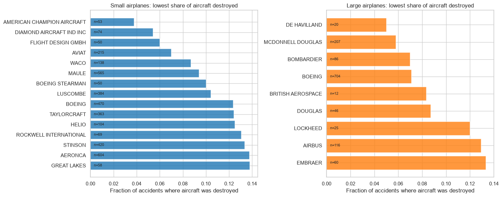
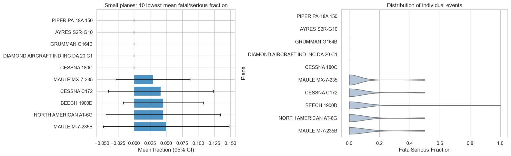
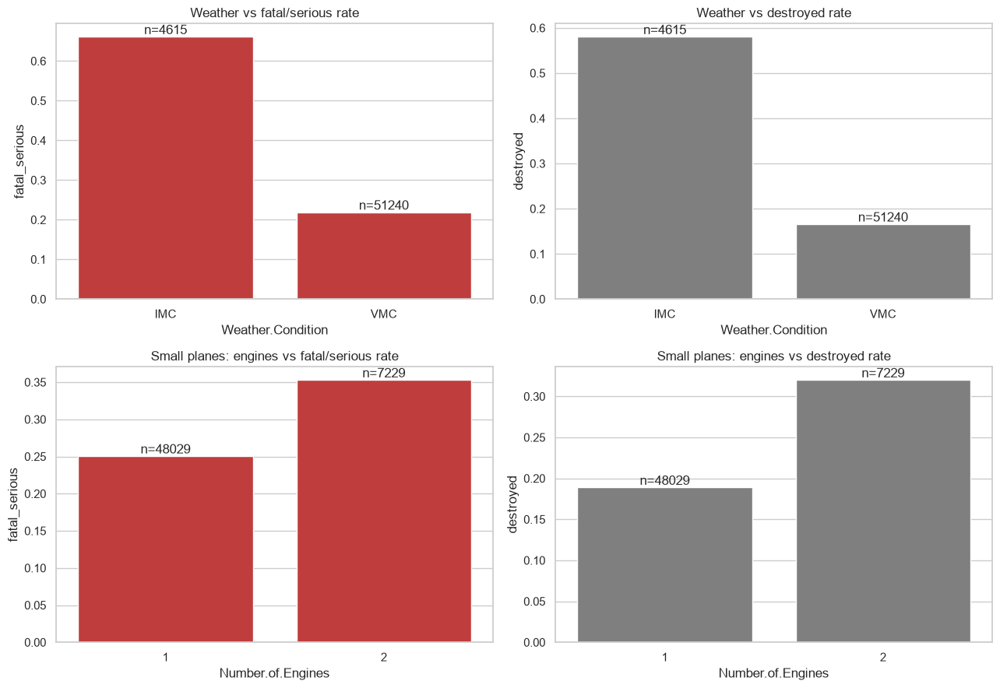

# Aviation Accident Analysis

An exploratory data analysis of airplane accidents (1983-2023) to identify which aircraft makes and models are safest when an accident occurs. Built for an airline/airplane insurer that wants recommendations for **small aircraft** and **large passenger aircraft** separately.

---

## Table of Contents

1. [Business Problem](#business-problem)
2. [Data](#data)
3. [Project Structure](#project-structure)
4. [Methodology](#methodology)
5. [Key Findings](#key-findings)
6. [Recommendations](#recommendations)
7. [How to Run](#how-to-run)
8. [Limitations](#limitations)

---

## Business Problem

The client insures commercial and passenger aircraft. They want to know which makes and models:

- have a **low rate of total destruction**, and
- have a **low likelihood of fatal or serious injury** to people on board,

and which general conditions (weather, engines, etc.) influence these outcomes.

**Client constraints**

- Professional builds only (no home-built aircraft).
- Only models that could still be active: a maximum 40-year lifetime, so events from **1983 onwards**.
- Separate recommendations for small and large aircraft (threshold: 20 people on board).
- Claims must be statistically robust, with enough samples in every comparison.

---

## Data

| File                            | Description                                                          |
| ------------------------------- | -------------------------------------------------------------------- |
| `data/AviationData.csv`         | Raw accident records, 88,889 rows and 31 columns, covering 1948-2023 |
| `data/USState_Codes.csv`        | US state names and abbreviations (not used in this analysis)         |
| `data/AviationData_Cleaned.csv` | Cleaned dataset, 57,968 rows, produced by the cleaning notebook      |

---

## Project Structure

```
.
├── Aviation_Accidents_Cleaning.ipynb        # Step 1: load, filter, clean, save
├── Aviation_Accidents_Data_Analysis.ipynb   # Step 2: EDA, recommendations, other factors
├── images/                                  # charts used in this README
├── data/
│   ├── AviationData.csv
│   ├── USState_Codes.csv
│   └── AviationData_Cleaned.csv             # generated by Step 1
└── README.md
```

Run the notebooks **in this order**: cleaning first, then analysis.

---

## Methodology

### Step 1: Cleaning (`Aviation_Accidents_Cleaning.ipynb`)

| Task              | Approach                                                                                                                                                                      |
| ----------------- | ----------------------------------------------------------------------------------------------------------------------------------------------------------------------------- |
| Time window       | Kept events from 1983 onwards                                                                                                                                                 |
| Build type        | Kept `Amateur.Built == 'No'`                                                                                                                                                  |
| Aircraft category | Kept airplanes only. Missing categories were imputed as _Airplane_ when the engine type (piston, turboprop, turbofan, turbojet), engine count and make clearly fit            |
| People on board   | `Total.Passengers` = fatal + serious + minor + uninjured                                                                                                                      |
| Injury measure    | `FatalSerious.Fraction` = (fatal + serious) / people on board                                                                                                                 |
| Damage measure    | `Destroyed` = 1 if aircraft damage is _Destroyed_, otherwise 0                                                                                                                |
| Make names        | Standardised case and merged spelling variants (e.g. `AIRBUS INDUSTRIE` into `AIRBUS`). Kept makes with 50 or more records                                                    |
| Model names       | Model labels are not unique across makes, so a unique ID was created: `Plane` = `Make` + `Model`                                                                              |
| Other columns     | Recoded `Unknown`/`UNK` values in engine type, weather, flight purpose and phase as missing. Set engine count 0 to missing. Dropped columns with more than 50% missing values |

### Step 2: Analysis (`Aviation_Accidents_Data_Analysis.ipynb`)

- **Small vs large:** a plane type is _large_ if its **median** number of people on board is 20 or more. The median is used instead of the maximum because the data contains entry errors (for example a small Piper recorded with 90 people).
- **Statistical robustness:** makes need at least 30 events (small) or 10 events (large) to be ranked, plane types need at least 10, and recommendations require at least 50 events. Bars show 95% confidence intervals.
- **Visuals:** bar charts, violin plots (small planes) and strip plots (large planes) show both averages and distributions.
- **Significance testing:** Welch t-tests (injury fraction) and chi-square tests (destroyed share) for the weather and engine comparisons.

---

## Key Findings

### Large aircraft (20+ people)

| Make              | Events | Fatal/serious % | Destroyed % |
| ----------------- | ------ | --------------- | ----------- |
| McDonnell Douglas | 207    | 2.9%            | 5.8%        |
| Bombardier        | 86     | 6.5%            | 7.0%        |
| Boeing            | 704    | 6.7%            | 7.1%        |



Airbus (12%) and Embraer (14%) show higher injury rates in this data. Boeing has by far the most data, so its estimate is the most reliable. Types with near-0% injury rates include the Boeing 757, 747-400, 777 and 727 and the McDonnell Douglas MD-80 and MD-88, but each has only 10-36 events and should be treated as encouraging rather than proven.



The strip plot shows that most accidents cause no serious injury, and the averages are lifted by a few catastrophic crashes.



### Small aircraft (under 20 people)

| Make              | Events | Fatal/serious % | Destroyed % |
| ----------------- | ------ | --------------- | ----------- |
| Waco              | 138    | 10.3%           | 8.7%        |
| Helio             | 104    | 13.2%           | 12.5%       |
| Grumman-Schweizer | 184    | 13.7%           | 17.9%       |

Diamond (5% destroyed) and Aviat (7% destroyed) are the most resistant to destruction, against about 21% for all small planes. Maule (15% injured, 565 events) has the largest sample among the top performers.







### Other factors

| Factor                 | Comparison            | Fatal/serious % | Destroyed % |
| ---------------------- | --------------------- | --------------- | ----------- |
| Weather                | Good visibility (VMC) | 22%             | 17%         |
| Weather                | Poor visibility (IMC) | **66%**         | **58%**     |
| Engines (small planes) | 1 engine              | 25%             | 19%         |
| Engines (small planes) | 2 engines             | **35%**         | **32%**     |



Both differences are statistically significant (p < 0.001). Accidents in poor visibility are about three times as severe. Twin-engine small planes have worse outcomes once an accident occurs, possibly because they are faster and flown in tougher conditions; this was not tested.

---

## Recommendations

- **Large aircraft:** McDonnell Douglas, Bombardier and Boeing.
- **Small aircraft:** Waco, Helio and Grumman-Schweizer for low injury risk; Diamond and Aviat for low destruction risk.
- **Underwriting:** treat operations in poor-visibility (IMC) conditions as substantially higher risk.

---

## How to Run

**Requirements:** Python 3.9+ and the packages below.

```bash
pip install pandas numpy matplotlib seaborn scipy jupyter
```

**Steps**

1. Clone or download this repository.
2. Start Jupyter:
   ```bash
   jupyter notebook
   ```
3. Run `Aviation_Accidents_Cleaning.ipynb` from top to bottom. This creates `data/AviationData_Cleaned.csv`.
4. Run `Aviation_Accidents_Data_Analysis.ipynb` from top to bottom.

---

## Limitations

- The dataset only contains planes that **had an accident**. It measures how severe accidents are, not how often they happen, because there is no data on flights or flight hours.
- Some plane types have small samples (10-20 events), so their averages can change a lot with a single crash.
- Injury and destruction rates depend on how each accident was recorded; some entries contain errors.
- Differences between groups, such as one-engine vs two-engine planes, show association, not cause.

---

## License

See the `LICENSE` file for details.
